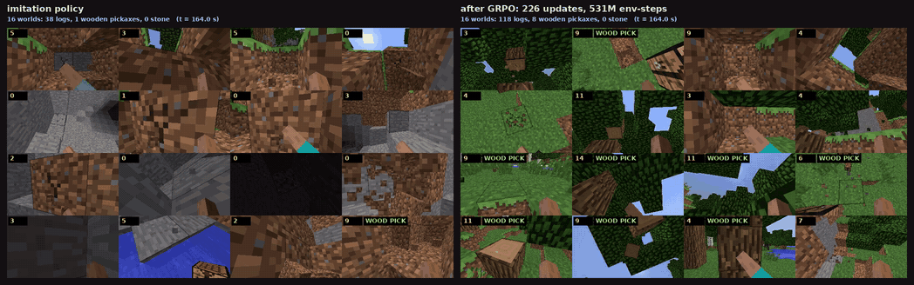

# netherite

Minecraft 1.7.10 rewritten in C and CUDA, exact against the real Java client, with a batched RL environment in the
PufferLib style and a native trainer (C and CUDA, no Python) on top.

<p align="center">
  
</p>
<p align="center"><i>Sixteen seed-1 worlds, three minutes in: the imitation policy (left) and the same policy after
226 GRPO updates (right). Every frame is the C engine's. Still: <a href="docs/demo.png">docs/demo.png</a>.</i></p>

- **Exact.** 874 of the 875 in-scope vanilla source files are ported and checked bit for bit against the Java client
  (`index/summary.json`; the last one is partial), and the seed-42 golden chain plays from a fresh world to the
  dragon's death with every field of every tick equal to Java's (`csrc/play/chain.sh`).
- **An environment.** One run is one YAML file: the world, the observation, the actions and macros, the fidelity and
  the trainer's recipe. Thousands of worlds step in one process on the CPU while the GPU learns; every env is a
  plain C struct, reset from a held image of its start.
- **A trainer.** `nether train` is PPO in C and CUDA (the actor, the learner and the loop), and every episode it
  plays can be kept as data and played back on the real Java client.

You need your own copy of Minecraft 1.7.10 (installed once with the official launcher, or any launcher directory
with `versions/1.7.10/`) and JDK 8. No Mojang content is in this repo: the oracle's source and the textures are
rebuilt from your install by `nether setup`.

## Quickstart

```bash
make                                    # builds out/bin/nether
out/bin/nether setup                 # finds your 1.7.10 (--mc DIR), rebuilds the oracle and textures, builds everything
out/bin/nether gate --java           # the Java client records now; the C engine replays it row for row
out/bin/nether train configs/brute16fast.yaml --hours 0.5 --rec on
out/bin/nether score configs/brute16fast.yaml out/train/brute16fast-DATE-TIME/model.ntw 512 60 1000
out/bin/nether replay out/train/brute16fast-DATE-TIME/episodes.nrec 0
```

- `train` builds what the run file needs where it is missing (the trainer for its observation size, the textures,
  the cast's atlas, its start, recorded by the oracle) and runs `out/runtime/train/ntloop --run RUN.yaml`; ntloop's
  flags after the run file win over it (`--hours`, `--env-steps`, `--init W.ntw`, `--rec on`). The model, its Adam
  moments, `iters.jsonl` and `episodes.jsonl` land in `out/train/NAME-DATE-TIME`.
- `score` is the frozen eval: the model's actor fixed, RUNS episodes of MIN minutes from the run file's start, each
  milestone's share, the first time each is held, deaths and the depth with its standard error.
- `replay` takes one recorded episode (`out/runtime/train/ntrec list FILE` lists them), writes it as the Java
  client's script, plays it on the Java client from the episode's world, checks the client's end against the
  record's, and writes frames and an mp4 to `out/replay/NAME`. Only vanilla-fidelity episodes from the run's own
  start replay row for row: train with a fidelity ladder that ends at vanilla (`configs/ladder.yaml`) or at vanilla.
- `nether play` plays the C engine's own client and checks your session against Java when you quit;
  `nether help` lists every verb with an example.

Linux and macOS build and play; the trainer and the GPU paths need Linux, CUDA and clang. If you are an agent
reading this, read [AGENTS.md](AGENTS.md) first: it tells you how to build, check and report to your user.

## A run file

`configs/brute16fast.yaml` is the 16x16 recipe; `configs/brute.yaml` explains every key. Two parts at column 0:
`sim` (the environment, which the engine reads) and `policy` (the trainer's). What they configure:

| what | keys |
|---|---|
| seeds and starts | `sim.world.seed`; `sim.pipeline.start` (a name in `configs/checkpoints.tsv` or a snapshot); `policy.starts.seeds`, `archive` (starts saved at each milestone gained) |
| envs | `sim.pipeline.worlds`, `groups`, `episode_seconds`; `sim.performance.workers`, `layout` |
| observation | `sim.client.camera: raycast`, `observation: 16x16` or `64x64` (the 64x64 build has the conv stem), `ticks_per_step` |
| actions and macros | `policy.actions.macros` (`base`, or a list: surface, loot, mine, craft, iron, table-anywhere, strip, late, liquid, portal, end, fight, carry, seek, food), `picks` |
| fidelity | `sim.fidelity.spawning`, `random_ticks`, `weather`, `mobs`; `policy.ladder` (rungs from fast to vanilla on a schedule) |
| precision | `sim.client.cast_precision` (64, 32, 16 or fixed for the ray cast); `sim.engine.raycast` (host or device) |
| recipe | `policy.ppo.*` (lr, ent, clip, gamma, lam, epochs, mb, horizon), `policy.run.hours`, `save_every`, `out` |
| data | `policy.record.episodes`, `keep`, `milestones`, `sample` (episodes kept as labelled data, `ntrec` reads them) |

The vanilla world switches (difficulty, render distance, villages, the features not ported yet) are `config.yaml`'s,
whose header is the grammar both parsers (Java and C) hold to.

## Measured on one RTX 3090

Each number is DEVLOG.md's, under the entry named.

| what | number | DEVLOG |
|---|---|---|
| trainer, 16x16 observation, configs/brute16fast.yaml (256 envs in 2 groups, the FP32 cast), learner on | 283,085 env-steps/s, 1.19x the 512-env shape (the env count is the lever: an L3 cliff on both Zen 5 CPUs) | 2026-11-01, lane/envcpu |
| the same, a 3-hour run from scratch | 255,235 env-steps/s average, 2.76B env-steps | 2026-11-01, the night's results |
| trainer, 64x64 observation (the stem), 256 envs, learner on | 148,028 env-steps/s, the default build (lane/nth16's 69,858 ran beside the nightly holding the GPU); the fused learner (.b.f, .fc: off by default) adds 0.8 to 1.6% | 2026-11-01, lane/ntfc, lane/ntbytes |
| the frozen 64x64 policy natively (eval, 256 envs) | 246k to 261k env-steps/s (PyTorch's: 81k to 109k on the same env) | 2026-11-01, lane/ntboot |
| native trainer against the PyTorch one on the same env | 1.10x | 2026-10-30, lane/ntwire |
| the fidelity ladder in the trainer: fast, stripped | 3.8x and 6.1x vanilla's env-steps/s | 2026-10-31, lane/ladder |
| the FP32 ray cast in the 64x64 trainer | +24%, 121 pixels a million off FP64's | 2026-10-31, lane/castf32 |
| episodes kept as data | 5.8 bytes an env-step compressed | 2026-10-31, lane/runrec |
| a trained policy from spawn, 180 s episodes, vanilla fidelity | stone pickaxe 82.8%, iron pickaxe 1.88% (an untrained net with the same macros: 18.3%, 0.20%) | 2026-10-29, lane/demo |
| those episodes on the Java client | 100 of 100 replayed episodes ended equal | 2026-10-29, lane/demo |
| the best model (s64-it42, 64x64), frozen, 60 minutes from spawn, vanilla fidelity | depth 4.55 of 13 milestones over 128 runs: iron pickaxe 46%, bucket 28%, flint and steel 35%, diamond pickaxe 5.5% | 2026-11-01, the night's results |
| its 8-milestone episodes on the Java client | 4 of 4 replayed episodes end with the simulator's inventory | 2026-11-01, the night's results |
| distilled into a student without the strip macro (`ntloop --teacher`) | depth 3.59 at 256M env-steps, above the teacher's own net at that level (2.97) | 2026-11-01, lane/ntbc |
| PPO on top of it with the KL anchor (`ppo.ref_kl`) | holds the start (4.78 and 4.80 against 4.73); without the anchor it erodes (4.23) | 2026-11-01, lane/ntppo |

## Layout

`oracle/` the Java oracle (Mojang's client, decompiled on your machine, plus the harness that records it),
`csrc/engine` the C engine, `csrc/cuda` the device code, `csrc/runtime` the env pool, the vector env and the trainer
(`csrc/runtime/train`), `csrc/play` the human client, `csrc/cli` this CLI, `configs/` run files and named starts,
`index/` the map from every vanilla file to its C port. SPEC.md is the architecture, DEVLOG.md the history.
